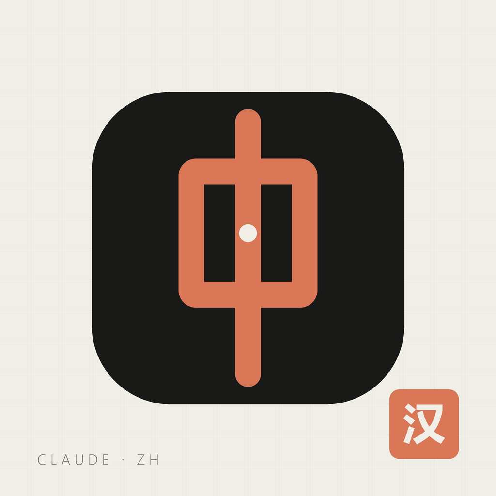
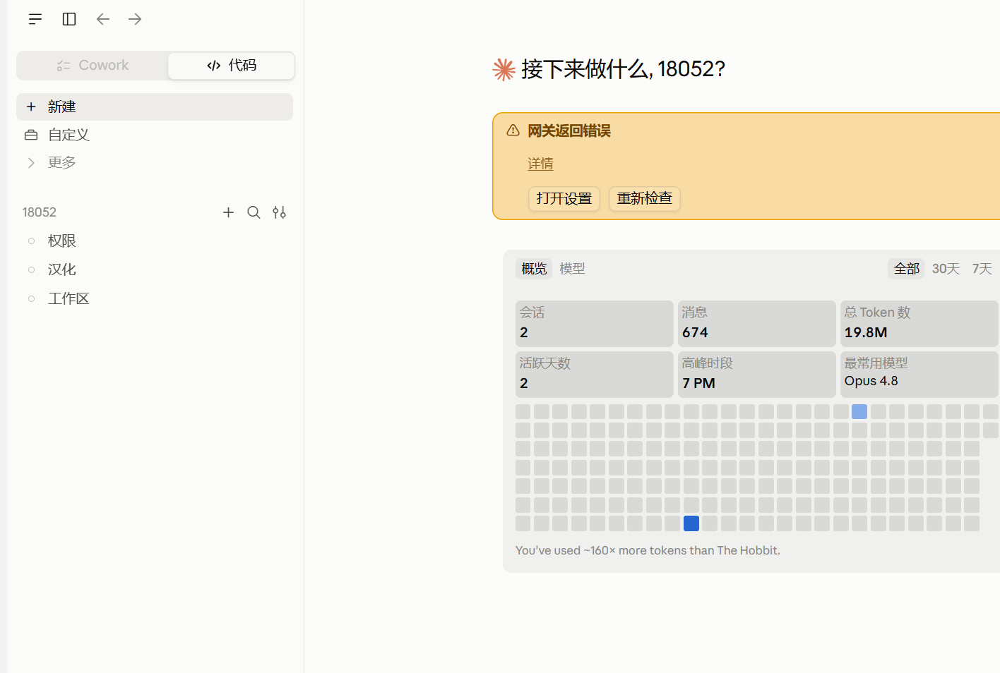
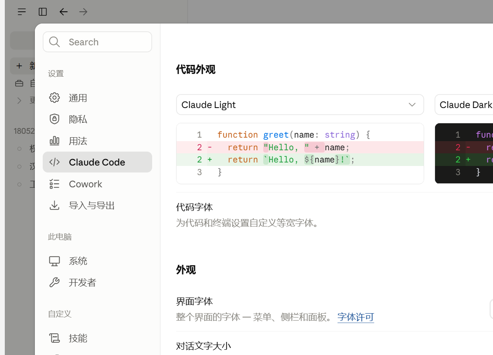
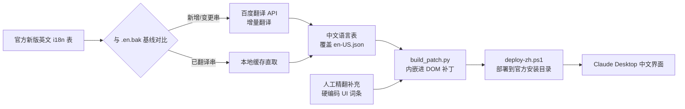

<div align="center">



# claude-desktop-zh

**Claude Desktop 桌面版 · 社区中文语言包与部署工具链**

_五层汉化 · 增量翻译 · 一键部署 · 全自动更新适配_

[](#)
[](#)
[](#)
[](#)
[](LICENSE)


</div>

---

> [!WARNING]
> **非官方项目**。与 Anthropic 无任何关联。Claude 及相关商标归 Anthropic PBC 所有。
> 本工具链不修改应用代码逻辑、不接入任何非官方接口,仅做界面文本本地化。

## 这是什么

[Claude Desktop](https://claude.com/download) 桌面版官方至今没有简体中文界面。
本项目通过**可更新的语言包 + 前端补丁**让桌面版完整显示中文,并附带一套
自动适配新版更新的部署工具链 —— 升级后重新汉化只需几分钟。

## ✨ 特性

| 层 | 覆盖范围 | 机制 | 中文来源 |
|---|---------|------|---------|
| ① SPA 主界面 | 聊天 / 侧栏 / 大部分页面 | i18n 表中文覆盖(en-US 回退机制) | 百度翻译 API + 增量缓存 |
| ② 动态字符串表 | 运行时拼接文案 | 同上(v2.42304+ 新增 dynamic 表) | 同上 |
| ③ 硬编码 UI | 设置页、新 UI 硬编码串 | DOM 文本替换补丁(内嵌 map,免缓存) | 人工精翻 |
| ④ 原生外壳 | 标题栏 / 右键菜单 / 托盘 | 官方 `zh-Hans.json` 覆盖(≥2.42304) | **Anthropic 官方** |
| ⑤ Skill 显示名 | 技能卡片文案 | 注入式 map 轮询补丁 | 百度翻译 API |

**当前覆盖率**:SPA 主表 91.7%(32,512/35,441)+ 动态表 100% + 原生层官方中文。
刻意保留英文:品牌名(Claude / Cowork / Opus 4.x)、官方彩蛋句、开发者调试菜单。

## 📸 截图

| 主界面 | 设置 |
| --- | --- |
|  |  |

## 🚀 快速开始

### 前置条件

- Windows 10 / 11,已安装 [Claude Desktop](https://claude.com/download)(MSIX/Squirrel 均可)
- Python 3.10+,`pip install` 无第三方依赖(纯标准库)
- [百度翻译开放平台](https://fanyi-api.baidu.com/) API 凭据(标准版免费即可,QPS=1)
- PowerShell 5.1+(系统自带)

### 首次安装

```bat
git clone https://github.com/Jensen-Yao/claude-desktop-zh.git
cd claude-desktop-zh

:: 1. 把 Claude 官方资源里的英文语言表拷进工作区
::    (仓库根目录下需要 Claude/resources/... 结构, 见 docs/README-workspace.md)

:: 2. 配置百度翻译凭据文件路径 (编辑脚本顶部的 CREDS_FILE 或设置环境变量)
set BAIDU_CREDS=D:\path\to\your\baidu_credentials.txt

:: 3. 生成中文语言表 (增量翻译, 已翻过的走缓存)
python scripts\gen_i18n_zh.py --run
python scripts\gen_zh_map.py --run

:: 4. 构建内嵌补丁 + 一键部署
python scripts\build_patch.py
powershell -ExecutionPolicy Bypass -File scripts\deploy-zh.ps1
```

### Claude 更新后重新汉化

```bat
:: 商店/Squirrel 自动更新后, 把新版英文表拷进工作区, 然后:
refresh-zh.cmd          :: 增量翻译 (只翻新增串, 走缓存几乎零成本)
python scripts\build_patch.py
powershell -ExecutionPolicy Bypass -File scripts\deploy-zh.ps1
```

> [!TIP]
> 整个"更新 → 重新汉化"流程通常 **3-10 分钟**,其中翻译只处理新增串
> (本项目实测:2.42304 → 2.42304+ 新增 4,428 串仅花 8 分钟)。

## 🧭 工作原理



核心机制:**Claude 的 SPA 在找不到当前语言表时会回退到 `en-US.json`**。
把翻译后的中文直接写入 `en-US.json`(备份 `.en.bak`),
整个界面即变为中文 —— 无需修改任何应用代码。

## 🩹 踩坑实录

两年长期使用沉淀出的真实坑位,每一条都踩过并解决,详见 [docs/pitfalls.md](docs/pitfalls.md):

| 坑 | 症状 | 解法 |
|----|------|------|
| EFS 加密资源目录 | `robocopy` 静默复制 0 个文件;`Copy-Item` 全部写入失败 | tar 字节流管道复制 |
| 商店更新接口 403 | Squirrel 自动更新静默失败数周 | 走系统代理;直连被区域封锁 |
| 百度 52002 毒批次 | 整批翻译必失败,重试无效 | 二分拆解,毒串留英文并记录 |
| `Start-Sleep 1200` | 脚本"卡死"20 分钟 | PowerShell 的 Start-Sleep 单位是**秒** |
| Windows 计划任务无桌面 | GUI 自动化全部哑炮 | `/it` 交互标志或改用系统级触发 |
| Electron asar 完整性 | 改包后应用拒启 | 放弃改包,走 DOM 补丁路线 |
| 设置窗口 map 缓存 | 新词条永不生效 | map 内嵌进补丁,不再 fetch |
| WinINET 前台锁 | `SetForegroundWindow` 不生效 | `AttachThreadInput` 线程附着 |

## ❓ FAQ

<details>
<summary><b>会影响 Claude 官方自动更新吗?</b></summary>

不会。语言表是独立资源文件,更新只覆盖应用本体。更新后重新跑一遍部署脚本即可重新汉化。
</details>

<details>
<summary><b>为什么不用 MSIX 备份/直接改包?</b></summary>

2.42304+ 启用了 asar 完整性校验,修改应用包会被拒绝启动。本项目所有补丁都放在应用外部,升级零风险。
</details>

<details>
<summary><b>翻译质量如何?</b></summary>

机翻(百度)+ 人工校对混合:通用 UI 由机翻覆盖,高频短词与易错词内置 60+ 条人工修正表
(<code>MANUAL_OVERRIDES</code>),品牌名保护列表防止"Claude→克劳德"式翻车。彩蛋句与品牌名刻意保留英文。
</details>

<details>
<summary><b>支持 macOS 吗?</b></summary>

不。本项目的部署脚本、补丁注入和原生层机制都是 Windows 专属。macOS 欢迎社区移植。
</details>

## 📄 目录结构

```
claude-desktop-zh/
├── scripts/
│   ├── gen_i18n_zh.py    # 主翻译管线 (SPA i18n + 动态表 + 原生表)
│   ├── gen_zh_map.py     # Skill 显示名映射生成
│   ├── build_patch.py    # 把 map 内嵌进前端补丁 (免缓存)
│   ├── deploy-zh.ps1     # 一键部署到官方安装目录
│   └── refresh-zh.cmd    # 更新后一键增量翻译
├── logo/                 # 图标与横幅 (含设计哲学文档)
├── assets/               # 截图
└── docs/pitfalls.md      # 完整踩坑记录
```

## 🙏 致谢

- [Anthropic](https://www.anthropic.com) — Claude 与官方 zh-Hans 原生翻译
- [百度翻译开放平台](https://fanyi-api.baidu.com/) — 免费翻译 API

---

<div align="center">

**如果这个项目帮到了你,欢迎点个 ⭐**

Made with 🍵 and 朱砂 by Jensen-Yao

</div>
